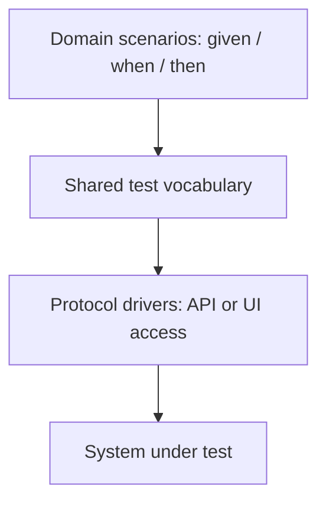

# Verification principles to evaluate

These are ideas to investigate, not new package requirements or accepted substitutes for the current workflow. Keep an idea when evidence shows useful fault detection or clearer work at proportionate cost; revise or drop it when it does not help. [Decision 019: Use spec-driven development with evidence-first verification](../decisions/019-evidence-first-verification.md) remains the current method.

## Inspiration and source limits

The owner supplied notes inspired by [The Industry Is Catching Up: The Only Way to Generate AI Code That Works](https://www.youtube.com/watch?v=EkH_uoybj8k), from Modern Software Engineering. YouTube's metadata confirmed the title and channel; the video itself could not be retrieved during this review. The points below record the owner's interpretation and subsequent discussion, not a verified transcript or verified claims about the practices of particular people.

Assess whether tests detect relevant faulty behavior. A red/green cycle is one possible technique; controlled faults or mutation testing can establish effectiveness after implementation too, consistent with the current evidence-first method.

## Ideas worth investigating

| Idea | What to assess | Reason to revise or drop it |
|---|---|---|
| Strong verification around agent work | Combine relevant unit and domain acceptance tests, QA checks, risk-based quality measures, and controlled faults or mutation testing | Extra gates add cost without detecting relevant mistakes or encourage meaningless scores |
| Agree behavior before implementation | Describe scenarios in domain language and work on a small coherent slice | Scenario splitting obscures interactions or creates artifacts without useful decisions |
| Test the tests | Show that relevant wrong behavior fails an assertion, using a controlled fault, mutation, or an observed behavior failure | A claimed failure comes from syntax, setup, or unrelated behavior rather than the intended assertion |
| Protect the acceptance contract | Keep an independently checked baseline or require approval from a separate authority for material changes | The implementer can silently weaken the contract, or controls block legitimate maintenance without adding confidence |
| Short feedback cycles | Verify a slice, review its outcome, and commit at a useful boundary | A rigid commit or interaction rule slows routine work without making deviations easier to detect |
| Separate behavior from implementation | Give the agent freedom over implementation within agreed observable behavior and constraints | Tests unnecessarily prescribe internals or neglect essential operational constraints |
| Layer acceptance tests | Keep domain scenarios separate from test vocabulary and system access | Abstraction adds complexity to a small suite or merely moves brittle UI details elsewhere |
| Proportionate autonomy | Let agents complete trivial, authorized work without repeated human approval; use independent verification where it adds value | Either unnecessary waiting or changes to intent and authority that nobody agreed to |

## A possible acceptance-test structure

A domain-specific language (DSL) is a small shared test vocabulary. Protocol drivers translate that vocabulary into calls through the system's API, UI, or another real boundary.

The purpose is to keep the behavioral meaning stable when implementation or access details change. Evaluate whether each layer earns its maintenance cost. Gherkin syntax, a separate DSL, and a mutation framework are options to assess, not universal dependencies.

## Autonomy and contract ownership

A stable acceptance contract does not require a human to approve every test edit. A separate evaluator or reviewer can check that implementation changes preserve it when project policy delegates that authority. Clarify material changes in intent, significant scope changes, or actions requiring authorization. Existing permission is sufficient for routine actions within its scope.

Source-control review and instruction-level restrictions detect or discourage tampering; they are not proof of technical isolation. If tests must be inaccessible to the implementation agent, assess actual tool permissions or execution isolation rather than claiming protection because a prompt says so. Tests still need legitimate maintenance as accepted behavior evolves.

## How to evaluate

Start from a concrete failure risk and the cheapest useful check. Record the defect detected, what remained undetected, maintenance and execution cost, and agent/user feedback. A relevant fault causing a test failure is evidence about that fault only; a green suite or quality score does not establish complete correctness.

The requested combined scoping-and-archive trial evaluates the already implemented workflow. It does not validate all the candidate principles here or change existing approval boundaries. Future experiments should be scoped when selected, with explicit criteria for keeping, revising, or dropping the idea. Do not prepare dependent implementation proposals in advance.
