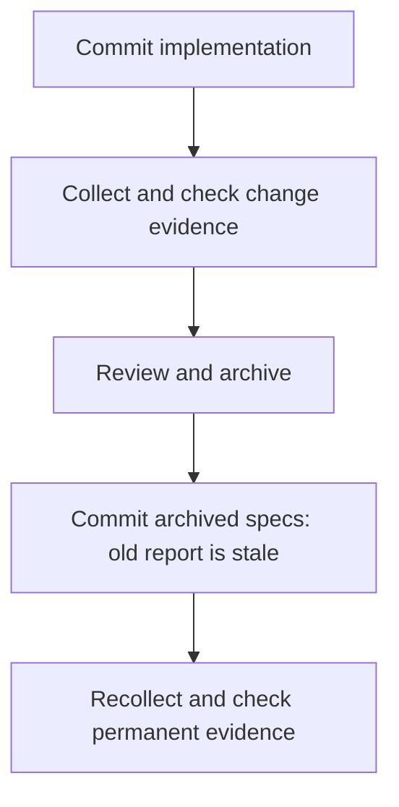

# Your first change

This guide takes a small CSV exporter from a new project to archived OpenSpec specs. Use a separate repository so you can review everything the package installs. You need Git, npm, and Node.js 22.12 or newer for the OpenSpec 1.17.0 npm installation used here. Cliewen itself supports Node 20.19+; see [version compatibility](../configuration.md#version-compatibility) for that installation path. Node 22 or 24 matches the versions used in package CI. Configure a Git name and email before the commit steps.

The commands follow a prepared example without a coding agent. For an agent-authored change, choose [agent setup](existing-projects.md#coding-agents) before initialization and use the [reference prompt](../testing/pilot-prompt.md#prompt). Allocate IDs for that agent's reviewed scenarios; the fixed six-ID allocation and copy helpers below belong to the prepared path.

## 1. Build the candidate package

This worked example builds version `0.2.0` locally and uses its prepared CSV files. Version 0.2.0 is an unreleased candidate; use this source-build route to evaluate it. Published installations can use `cliewen-openspec@0.1.0`, which lacks the new guidance. The earlier published `0.1.0-alpha.1` has a different feature set and is not the package exercised by this guide; do not substitute it into this walkthrough.

From an empty parent directory, clone the source repository and build the package:

```sh
git clone https://github.com/cliewen-openspec/cliewen-openspec.git
cd cliewen-openspec
npm pkg get version
git rev-parse HEAD
```

Expect version `"0.2.0"`; stop before building if the checkout differs. Record its Git revision because the default branch can change during development. Then build the package:

```sh
npm ci
npm test
npm pack
```

Each build command must succeed before you continue. `npm test` must have no failing tests; `npm pack` produces `cliewen-openspec-0.2.0.tgz`. If a command fails, preserve its output and stop to resolve or report it. The commands below assume that the clone and pilot are sibling directories.

## 2. Create the pilot

From the source repository, move up one directory and create the pilot:

```sh
cd ..
mkdir cliewen-pilot
cd cliewen-pilot
git init -b main
npm init -y
npm install --save-dev @fission-ai/openspec@1.17.0
npm install --save-dev ../cliewen-openspec/cliewen-openspec-0.2.0.tgz
node -e "require('node:fs').writeFileSync('.gitignore', 'node_modules/\n')"
```

The last command creates `.gitignore` for this new pilot, excluding installed dependencies from commits. If the pilot needs a Git identity, set it locally with `git config --local user.name "Your Name"` and `git config --local user.email "you@example.com"`, using your own values. Initialize OpenSpec without agent integrations for the reproducible example:

```sh
npx --no-install openspec init --tools none --no-animation
npx --no-install cliewen-openspec init --default --dry-run
```

Stop and read the preview before applying. Confirm the intended schema/template, configuration, and documentation writes, plus the ownership manifest and `.cliewen-openspec/.gitignore`. The ignore file keeps generated reports and transaction state out of Git. `--default` includes a change to `openspec/config.yaml`. Run the following commands only after reviewing that output:

```sh
npx --no-install cliewen-openspec init --default
git add .
git commit -m "Install OpenSpec and Cliewen"
```

`npx --no-install` runs the locally installed command. OpenSpec creates the change/spec structure. Cliewen's dry run lists proposed writes. Its `init` installs the delivery, discovery, and combined schemas, Decision Record and learning templates, project configuration, a documentation entry point, and an ownership manifest. `--default` sets `schema: cliewen-delivery` in `openspec/config.yaml`; omit it to preserve your current default.

Both Cliewen commands select the same default, so the preview includes that configuration change. The commit records installation separately from the feature you will implement next.

## 3. Configure acceptance IDs

Edit `.cliewen-openspec/config.yaml`: under the existing `ac:` section, replace `capabilities: {}` with the `csv-export: EXP` mapping shown below. Merge these values into the existing sections; do not append duplicate `ac:` or `testing:` keys. Keep other generated settings:

{{include:docs/examples/csv/config.yaml}}

`csv-export` is the capability name and will also be its specs directory name. `EXP` is a prefix chosen for that capability. The generated file already has `padding: 3`, `placement: per-task`; leave those defaults in place for this exercise.

Start the change and allocate its six scenario IDs:

```sh
npx --no-install openspec new change add-csv-export --schema cliewen-delivery
npx --no-install cliewen-openspec ac next --capability csv-export
```

The first allocation prints `EXP-001`. Run the allocation command five more times for `EXP-002` through `EXP-006`. It updates `.cliewen-openspec/ac-registry.json`. Commit that registry with your specs. Do not reset it or reclaim unused numbers.

## 4. Write and review the proposal

Review the proposal, specs, design, and tasks. Each scenario heading should carry its allocated ID and have one `Test-type` line below it. Each implementation task should name its concrete tests, type, boundary, and completion check. The default types are Unit, Integration, and E2E; [configure your own types](../configuration.md#test-types) to preserve project terminology. For the Node adapter, tag each mapped test title with its AC ID and `[Test-type: Unit]`, or the matching configured type.

For a repeatable walkthrough without an agent, copy the prepared artifacts from the source clone:

```sh
node ../cliewen-openspec/scripts/copy-csv-example.mjs plan
npx --no-install openspec validate add-csv-export --type change --strict
```

The helper copies the example proposal, design, tasks, and delta spec into the existing change. It refuses to overwrite a file. Stop here and read those files before running an implementation command. Review the string-valued fields, explicit column names, CRLF separators, and the verification commands in `tasks.md`. If validation or copying fails, read the error and preserve the pilot for inspection; use a fresh pilot for a clean retry instead of deleting ownership or identity records.

## 5. Implement and test

After reviewing the plan, copy and test the prepared implementation:

```sh
node ../cliewen-openspec/scripts/copy-csv-example.mjs implementation
node --test test/export.test.mjs
```

The implementation helper creates `export.mjs`, `test/export.test.mjs`, and `README.md`. Expect six passing tests and no failures. They cover headers, explicit column order, commas, quotation marks, line breaks, and an empty record list. Inspect the [CSV code and tests](csv-example.md) to see exactly what they assert. Copying finished files does not exercise an agent's implementation process or prove task-by-task development.

Stop and read `export.mjs`, `test/export.test.mjs`, and `README.md`. Compare the assertions with the six scenarios in `openspec/changes/add-csv-export/specs/csv-export/spec.md`. For the prepared path, the full suite above verifies all six behaviors together; the task file explicitly allows that batch check instead of its incremental focused commands. This shortcut does not claim those focused runs or task-by-task development. After implementation, validate again:

```sh
npx --no-install openspec validate add-csv-export --type change --strict
```

The completion helper is only for the supplied reference files. It checks their contents, not test execution or review. Use it after the checks and review above; it marks all reference tasks complete:

```sh
node ../cliewen-openspec/scripts/copy-csv-example.mjs complete
```

Commit the reviewed implementation:

```sh
git add .
git commit -m "Implement CSV export"
```

## 6. Collect evidence

Collect from a clean, committed tree: `git status --porcelain` should print nothing. Keep any collection logs outside the pilot or in an ignored directory.

```sh
node node_modules/cliewen-openspec/adapters/node-test.mjs --change add-csv-export test/export.test.mjs
npx --no-install cliewen-openspec check --change add-csv-export --json
```

The adapter runs every test in the file again and writes `.cliewen-openspec/evidence.json`, ignored by Git. Open it and compare its `revision` with `git rev-parse HEAD`; `scope.change` should be `add-csv-export` (the `scope` value is an object). Failures outside the selected change still block verification.

With the `0.2.0` candidate and unchanged reference example, expect exit 0 and `"ok": true` with these warnings:

| Code | Count | Reason |
|---|---|---|
| `coverage-metadata-missing` | 6 | The six tagged tests have no Case/Coverage metadata |
| `coverage-minimum-unmet` | 12 | Tests without Case/Coverage metadata count as zero declared cases, leaving one positive and one negative case missing per scenario |
| `test-review-missing` | 2 | Effectiveness and lifecycle assessments are absent |

The informational findings `sufficiency-not-assessed` and `test-policy-review-required` remind you to review assertion quality. `ok` means no blocking finding; it does not establish that the tests are sufficient.

These advisory warnings do not prevent continuing this exercise after reviewing the code and assertions. Follow [test quality and lifecycle](../testing/test-quality.md) to add assessments or disable individual policies. The published 0.1 alpha does not produce the new policy findings. If a check fails, use [evidence troubleshooting](../testing/evidence.md#troubleshooting).

## 7. Archive and refresh evidence

After reviewing the change and evidence:

```sh
npx --no-install openspec archive add-csv-export --yes
git add .
git commit -m "Archive CSV export"
node node_modules/cliewen-openspec/adapters/node-test.mjs test/export.test.mjs
npx --no-install cliewen-openspec check --json
```

OpenSpec merges the delta into `openspec/specs/csv-export/spec.md` and moves the change into its archive. Its `+ 3 added` summary counts requirements, not the six scenarios. Archive changes the Git revision, so the previous report becomes stale. The last two commands regenerate evidence and check the permanent specs. For stale or scope-mismatch failures, follow [evidence troubleshooting](../testing/evidence.md#troubleshooting).

`--yes` skips archive confirmation prompts; it does not replace your review. OpenSpec archive does not run Cliewen's evidence checker, so review the preceding check before archiving. After archive, omit `--change` because the scenarios now belong to permanent specs. The same advisory quality warnings remain until assessed, now using `.cliewen-openspec/reviews/specs.yaml` for review records.

Expect six passing tests and `"ok": true` with the same advisory warning categories. Confirm the permanent spec is valid and the working tree is clean:

```sh
npx --no-install openspec validate csv-export --type spec --strict
git status --porcelain
```

Validation should pass and Git should print nothing. The permanent spec retains EXP-001 through EXP-006; the active change has moved to a dated directory under `openspec/changes/archive/`.

Open `.cliewen-openspec/evidence.json` again: its `revision` should match the new `git rev-parse HEAD`, with no `scope` key because it now covers permanent specs.



You now have the implementation, tests, permanent behavior specs, and a fresh evidence report. For the next change, allocate new IDs for new scenarios and preserve IDs for existing behavior.
