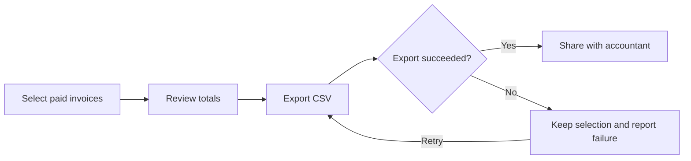
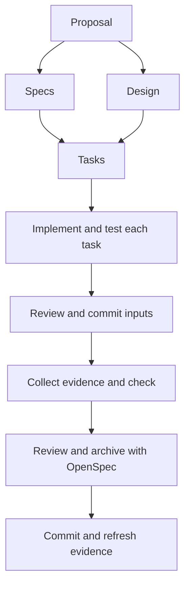

# From proposal to archive

Choose `cliewen-delivery` when you understand the problem and are ready to specify and implement a change. OpenSpec uses one schema per change. The default schema in `openspec/config.yaml` applies to new changes; changing it does not rewrite an existing change's schema selection.

## Choose the next delivery

The development source adds work-scoping guidance and installs `.cliewen-openspec/planning.md`. These additions are not in published 0.1.0. Evaluate a local build in a separate project or follow the supported published-0.1.0 resource-refresh route in [the update guide](updating.md). General project-content migrations remain outside that route.

Start with the smallest result that can be understood and verified together. New behavior, changed requirements, or material design choices usually need an OpenSpec change. A small correction restoring documented behavior can use relevant checks without a new proposal. Reassess if investigation expands the scope. Small implementation tasks can stay within one change; genuinely independent changes can proceed in parallel.

When a proposal grows too large, keep the next coherent delivery and preserve later work in your planning authority. Reconcile the current proposal, specs, design, and tasks. For example, deliver CSV export first and keep scheduled export as a future plan item with its purpose and dependencies. Write that later proposal after the first delivery teaches you more.

For consequential choices, identify the riskiest assumption, an alternative, a cheap useful investigation, and the result that would stop or revise the approach. Ask whether meeting every criterion could still fail the intended user. Routine work needs no extra report. Reassess goals and dependencies when resuming work or encountering contradictory evidence.

### Keep the user's outcome in view

Development source adds `.cliewen-openspec/product-context.md`; published 0.1.0 does not contain it. The reference helps agents compare a change with the agreed problem, user outcome, and delivery scope. Start with the existing product brief, README, or selected planning authority. A separate `goal.md` is optional. Keep unknown intent and success measures unknown until there is a source for them.

A journey is useful when a user needs several capabilities to achieve an outcome. Keep behavioral rules in OpenSpec and link to them by descriptive title. For a small correction, the existing explanation is often enough; no new document or interview is required.

This illustrative invoicing example has a proposed outcome: a reviewer can pass the selected paid-invoice totals to an accountant without entering the totals again. It describes an example product, not a Cliewen feature or observed user feedback:



In that product, link “Review totals” to its invoice-totals spec and “Export CSV” to its CSV-export spec, using the actual project paths and descriptive titles. The retry path needs a corresponding behavioral contract; drawing it does not make it implemented. Component tests may pass while the handoff still loses the selected invoices. Record that gap and assess it through the normal OpenSpec change workflow.

Use the same context to detect drift and scope creep. Adding automatic invoice scheduling might support the product's wider purpose while exceeding an agreed CSV-export delivery. Keep that wish for separate prioritization in the selected plan or tickets when planning is enabled. With planning disabled, note the additional scope in the current handoff. Obtain direction before material expansion; ordinary authorized implementation choices and necessary in-scope corrections can proceed with relevant verification. Do not rewrite the goal to justify work that has drifted.

`features.documentation` controls optional intent/journey record creation and maintenance; `features.planning` independently controls ticket access and plan updates. With documentation disabled, preserve existing records and add no documentation work. Supplied product context can still inform scoping. When a durable explanation helps, reuse existing documents and paths; optional new examples are `product-intent.md` or `journeys/reconcile-invoices.md` under `docsRoot`. Installation creates neither.

During review and closure, reconcile affected explanations with actual behavior. Distinguish the desired outcome, delivered capabilities, and observed results. State when no user observation was collected. A diagram, passing tests, or archive alone does not prove that users achieved the outcome.

### Tickets or a local plan

`features.planning` defaults to `true`. Use one existing authority for upcoming work. A ticket-backed proposal can refer to “ABC-123: Export invoices” with its original ID and a descriptive link to the actual ticket. Use an OpenSpec name such as `add-invoice-export`; the link preserves the ticket identity.

For local planning, an existing plan can be as small as:

| Delivery | Desired result | Dependency | Status |
|---|---|---|---|
| CSV export | Download the selected invoices | None | Next |
| Scheduled export | Receive exports on a schedule | Learn from CSV export | Later |

Keep the goal beside the table when useful. Separate goal documents and a backlog for isolated tasks are optional. If your ticket system owns status, link to it from repository documents instead of maintaining another status list.

Your agent can discover exposed MCP servers, connectors, or CLI tools for the selected ticket system. You connect the service and grant access. Read access, write capability, and permission for a particular update are separate. If access is missing or fails, the agent reports the limitation and gives you the pending manual update. It must not report that update as completed.

To disable planning requests, edit the existing project configuration:

```yaml
features:
  planning: false
```

This skips planning-authority discovery, ticket access, and plan maintenance while preserving authored files. Change scoping, verification, and existing approval rules still apply.

### Make guidance available before creating a change

Schemas supply instructions after the agent retrieves them. To request assessment before change creation, add the [context-entry rule](../configuration.md#instructions-before-context-collection) to your existing agent instruction file, such as `AGENTS.md`. The development-source reference resolves the learning policy before broader context collection, even when planning is disabled.

Installation writes the reference, but does not edit your agent file or OpenSpec-generated skills. Without this opt-in, schema guidance cannot guarantee assessment before a change is created. This is agent guidance, not an automatic hook or a CLI check of decision quality.

For consequential unresolved choices, you can request the optional [grill-me interview](https://www.aihero.dev/skills-grill-me). It needs the host-exposed `grill-me` skill and its `grilling` dependency. The agent may suggest it; availability alone does not start it. If unavailable or declined, ordinary scoping continues. Confirm the conclusions before acting and preserve them in the relevant proposal, plan, or decision afterward. The package does not install these skills.

## Try a prototype when it can answer a question

Development source adds optional prototype guidance in `.cliewen-openspec/prototyping.md`. Published 0.1.0 does not contain it. No new configuration flag or schema is needed.

The agent first inspects available evidence and clarifies what it can. If material uncertainty remains that needs something concrete to try, it can suggest a bounded experiment. The suggestion states the question, expected learning, estimated effort, workspace, outputs, useful resource limits, and the decision it will inform. You choose whether to proceed. You can also request a prototype directly. Already agreed scope needs no repeated permission; a clear task proceeds without a prototype or interview.

For example, you might authorize two small lookup implementations using synthetic data in an existing ignored scratch directory, with a five-minute limit, to decide whether building an index is worth its cost. That authorizes the described experiment; it does not approve a production rewrite. If you decline, the agent continues ordinary clarification and leaves relevant uncertainty visible.

### Start from an investigative change

OpenSpec's explore mode does not write code. When discussion reaches an agreed experiment, follow its native handoff and capture-confirmation rules. The recommended route is a short discovery change:

```sh
npx --no-install openspec new change compare-lookup-options --schema cliewen-discovery
npx --no-install openspec instructions proposal --change compare-lookup-options --json
```

These commands create the change and retrieve writing instructions. The agent then writes the concise investigation proposal: question, scope, agreed workspace and limits, and decision criteria. It is a proposal for the experiment, rather than a detailed specification for the eventual product. After that artifact exists, retrieve the next instructions:

```sh
npx --no-install openspec instructions investigation --change compare-lookup-options --json
```

The agent performs only the agreed experiment during investigation and records its actual findings in `investigation.md`. The CLI supplies instructions; it does not build prototypes for you. If you explicitly choose [the combined workflow](all.md), its investigation can hold the experiment instead, with the existing decision boundary before product implementation.

Keep experimental code and checks in the agreed workspace. Preserve production code, acceptance tests, permanent specs, and acceptance-ID allocation while investigating. State actual isolation: an ignored directory is not an enforced sandbox. Label synthetic data, stubs, and unsupported behavior. A stopped, failed, or invalid experiment remains such; clarify any material expansion before proceeding.

### Keep what the experiment teaches

Separate what was observed, actual user feedback and its source, interpretation, and what remains unknown. Record methods and inputs so the conclusion can be assessed. If no user tried the prototype, say so. Scripted example feedback is not a live user observation.

Use the existing investigation artifact and, when planning is enabled, the selected ticket or plan item. Maintain useful reusable lessons only when learnings and documentation guidance are enabled, following index-first retrieval. With those facilities disabled, preserve authored files and keep findings in the native investigation artifact and handoff.

Use the result to proceed, investigate further, choose another approach, or stop. Record whether code will be discarded, kept as reference, or reviewed for further development. A useful prototype is not automatically production-ready. Write the eventual delivery proposal from current findings when that work is selected; retain remaining limits and existing approval rules.

Optional grill-me can help clarify choices before or after an experiment. The user requests the interview; it neither starts a prototype nor approves later delivery. Both the interview and prototype can be used independently.

## What writes each file?

| Step | Tool or person | Result |
|---|---|---|
| Initialize | OpenSpec, then Cliewen CLI | Project structure, installed schema, templates, and config |
| Plan | You and your coding agent | Proposal, delta specs, design, and tasks |
| Allocate IDs | Cliewen CLI | Persistent registry entries used in scenarios and test titles |
| Implement | Coding agent or developer | Code, tests, and relevant documentation |
| Review and commit | Developer and Git | Reviewed inputs at a clean revision |
| Collect evidence | Reference test adapter | Execution report for that revision |
| Check | Cliewen CLI | Installation and evidence findings |
| Archive | OpenSpec | Permanent specs and an archived change |



Specs and design both depend on the proposal. Tasks depend on both. Implementation starts after the tasks artifact exists; it does not require a test report before code has been written.

## Write a concrete request

Version `0.1.0` also offers [project learnings](../configuration.md#project-learnings) and [optional Humanizer use](../configuration.md#humanizer-and-writing). Enable learnings to retrieve relevant lessons before planning and review useful new observations at closure. Current specs and accepted decisions take precedence over old notes. Humanizer defaults to host-mediated automatic discovery, with one short status per session and clear-writing fallback when unavailable. These facilities are independent and are not included in the earlier published alpha.

Describe the desired behavior and where you want the agent to stop. The installed schema provides the method guidance. For example:

> Create a change proposal for CSV export with a header, explicit column order, escaped commas and quotation marks, and header-only output for an empty list. Use the existing change `add-csv-export`. Stop after proposal, specs, design, and tasks so I can review them before implementation.

Review the input scope, scenarios, and task checks. Once you are satisfied, authorize implementation. With the defaults, every implementation task gets its relevant tests and must pass before the next task begins. Plan acceptance cases before implementation and follow [evidence-first verification](../configuration.md#evidence-first-verification).

## Keep durable explanations useful

Code comments should explain intent, constraints, or surprising behavior rather than repeat the code. Commit messages should summarize the concrete change, with rationale or consequences in the body when useful. Adapt examples and diagrams to the format; a short comment or commit message rarely needs a diagram. Preserve code behavior, structured data, required syntax, and exact identifiers when editing.

The schema's writing guidance applies to all text the agent creates or edits, including proposals, specs, tasks, plain-text files, Markdown, code comments, docstrings, commit messages, pull-request descriptions, user-facing messages, and conversational replies. Adapt the explanation to the intended reader and format without assuming knowledge of the conversation. Start change descriptions with the problem, resulting behavior, and practical impact. Use plain language and concrete examples. Keep the overview brief and link to supporting detail while preserving requirements, important exceptions, and required artifact sections.

Give references descriptive names, such as "ADR-025: Keep exports synchronous", and explain why they matter when needed. Avoid bare IDs, repeated explanations, and generic background. PR descriptions also include relevant validation and limitations. Apply the diagram guidance below across these texts. These are agent instructions, not automated writing checks; unrelated agent sessions and external PR tools need their own project instructions.

Write natural prose using the fewest words that preserve meaning and required detail. This guidance applies whether or not a writing skill is available. Automatic Humanizer detection and installation suggestions are planned; the alpha does not implement them.

Use `docs/` for explanations that still matter after archive. A small formatter may need only a README API example. A choice that constrains future work may need a Decision Record created from `.cliewen-openspec/templates/decision.md`. Agent-authored choices start proposed; human agreement permits acceptance.

Use embedded Mermaid when it explains a structure or flow more clearly than prose alone, such as a request sequence, state transitions, or dependencies. Include a short explanation of the diagram's main point and maintain it with the surrounding text. Mermaid guidance is enabled by default through `features.mermaid`.

Prefer an informative illustration or diagram when it replaces a longer explanation. Give it a short caption or accessible description, and avoid repeating every detail in prose.

For file and directory trees, a plain-text code block is often easier to read:

```text
docs/
|-- architecture/
|-- decisions/
`-- testing/
```

ASCII and plain-text sketches are also useful for small flows such as `Request -> Validate -> Export`, or where Mermaid rendering is unavailable. Choose the clearest representation for the reader and maintain one version of each diagram. A diagram is optional when prose or a table explains the subject clearly.

The alpha guides the agent to maintain diagrams, but does not parse your project's Mermaid or validate document frontmatter. Disabling Mermaid guidance does not prevent plain-text examples.

Plans are optional. If Jira or another ticket system owns scheduling and status, link to it. Keep independent design and decision content in the repository without duplicating ticket status.

## Review evidence before archive

### Make decisions easy to assess

Development source adds a decision-material review and guidance for human observations; these additions are not in published 0.1.0. Before asking you to decide, the agent checks whether the explanation makes sense without the project conversation or implementation code. It links detailed specs and removes repetition while preserving required sections and important exceptions. Diagrams follow your existing settings and are useful when they shorten the explanation.

For example, an illustrative proposal summary could say:

> Add CSV export for the currently selected invoices so an accountant can reconcile them in a spreadsheet. Preserve the selection if export fails and let the user retry. Scheduled exports are outside this change. The unresolved decision is whether the CSV includes internal invoice notes.

Keep that explanation in the appropriate native proposal sections and link to the behavioral specs. A short summary does not replace acceptance criteria.

### Automate before asking for manual work

The agent first assesses whether its available authorized tools can perform a proposed manual step reliably. It automates suitable checks and preparation, then explains any remaining need for your judgment, access, or authority. An unavailable tool or failed automation is a limitation to report and reassess when capabilities change. Required approval still follows your project policy.

For example, an agent can check that an export downloads and contains the expected rows. Whether an accountant understands its headings may need actual user feedback. If that question matters, the agent prepares the file and asks for that specific assessment. Routine authorized work with sufficient verification proceeds without an extra human checkpoint.

### Keep human observations concrete

An illustrative observation might read:

> Alex checked the selected-invoice export on build abc123 using Firefox and Excel. They selected three invoices, downloaded the CSV, and opened it in Excel. All three rows and totals matched; the tax heading was unclear. Large selections and other spreadsheet applications were not checked.

This example is fictional. For real feedback, retain the supplied attribution, behavior, tested version, conditions, results, and limits; label missing details as unknown. Agent browser checks remain agent observations. If no human feedback was collected, report that when relevant.

Reuse an investigation, review, task note, ticket, or handoff. Optional durable records follow `features.documentation` and existing paths. Setting it to `false` adds no optional observation document; the handoff still reports actual results. External records independently follow `features.planning` and existing permissions. No new setting is needed.

Positive feedback records an observation. Change approval and release authorization require their own applicable authority. When behavior changes later, keep the original tested context, mark the affected observation as historical, and assess whether another check is needed.

An existing version-1 manual result can use `reason` to describe or reference an observation. It remains a warning, with the same scenario, test-type, scope, and Git-freshness checks; see [execution evidence](../testing/evidence.md). An older durable observation does not establish current execution evidence, and manual claims cannot replace failed automated checks. These instructions guide the agent; the CLI does not authenticate feedback or establish readability.

Version 0.1.0 and the 0.2.0 candidate check [test quality and lifecycle](../testing/test-quality.md). Coverage, effectiveness, and lifecycle default to advisory review; use configuration to disable or enforce each independently. These settings are unavailable in the earlier published alpha. Preserve useful assertions through refactoring and accepted behavior changes, and remove obsolete ones only after explicit criterion retirement.

A passing `check` confirms that the configured report matches the scenario references and current clean Git revision, with no blocking findings. Review the assertions as well: a test that only checks that an output exists may not prove the scenario.

Cliewen's instruction to check evidence is guidance. The alpha does not intercept OpenSpec's archive command. After archive, commit the new state and regenerate evidence before checking permanent specs. The [first-change guide](getting-started.md#7-archive-and-refresh-evidence) shows the commands.

## Close the change and preserve useful knowledge

Development source installs `.cliewen-openspec/closure.md` and links it from all three workflows' implementation instructions. This addition is not in published 0.1.0. The reference brings together the project's enabled documentation, decision, learning, planning, test-review, and evidence responsibilities. It requests agent review; it does not enforce document accuracy or intercept archive.

Before archive, compare the actual delivery with its agreed scope, maintain affected explanations and decisions, and preserve useful findings. Existing feature settings apply independently. For example, disabled planning skips ticket access, and disabled learnings preserve existing notes without requesting new ones. Routine work need not create a closure report, decision, or lesson.

A delivery follows its existing test and evidence contract. Discovery and combined no-delivery outcomes retain actual findings, uncertainty, and cleanup results. They do not need product test results for behavior that was never implemented.

### Use the reference from a separate archive session

OpenSpec 1.15.0 and 1.17.0 expose advisory archive inputs. For a repository-local Cliewen installation, add this entry to `openspec/config.yaml` if you want the archive skill to find the reference independently:

```yaml
operations:
  archive:
    guidance:
      - For changes using cliewen-delivery, cliewen-discovery, or cliewen-all, read .cliewen-openspec/config.yaml and .cliewen-openspec/closure.md and apply the relevant closure guidance before and after archive.
```

Merge the entry into your existing `operations.archive.guidance` list. Keep other entries, `operations.apply`, rules, context, schema selection, and comments. Do not replace the whole configuration with this snippet. Cliewen installation leaves this project-owned setting untouched.

For an active change, inspect what OpenSpec returns:

```sh
npx --no-install openspec instructions archive --change add-csv-export --json
```

The `operationGuidance` array should include the added entry and any previous guidance. The name must identify an existing active change; replace `add-csv-export` with your change. Native paths, archive steps, explicit choices, and project policy remain controlling. The entry applies to the three Cliewen schemas, so other workflows keep their own closure rules. Standalone-store layouts are outside this example's tested scope.

This reaches agents using an OpenSpec archive skill that reads operation inputs. Running `openspec archive` directly does not execute the reference. Request the review separately before and after that command. If operation inputs are unavailable in your tool setup, use the same manual path. Neither a missing reference nor an unavailable advisory lookup is a new archive blocker; report the limitation and use the applicable native workflow.

### Report what actually finished

After successful archive, inspect its actual destination and spec synchronization result. Repair affected links after the move. With planning enabled, revisit affected future tickets or plan items against what was learned. Use the project's completion criteria: a ticket may still need deployment or a human check. If ticket access is missing, read-only, fails, or lacks authorization, give the concrete pending update alongside the archive result.

If archive or synchronization fails, inspect the reported result and current files before retrying. Explain what changed and what remains. Preserve pending synchronization if the chosen native route leaves specs unsynchronized. Archive, ticket completion, and Git integration are separate facts.

Finish intended tracked documentation and planning edits before the final commit. For delivered behavior with evidence enabled, recollect permanent-spec evidence and rerun the check afterward, as shown in [archive and refresh evidence](getting-started.md#7-archive-and-refresh-evidence). Earlier revision-bound evidence becomes historical when archive or a later commit changes the inputs.

A short handoff should state the archive location, actual spec synchronization, remaining work, and verification limits. No separate report is mandatory.
