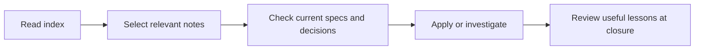

# Optional knowledge and writing support

## Configuration

```yaml
learnings:
  enabled: false
  directory: learnings
writing:
  humanizer: auto
```

Omitted settings use these defaults. Unknown keys and invalid types fail configuration validation. Humanizer accepts `auto`, `"on"`, or `"off"`. Existing installations need no new entries. Settings are read on the next workflow operation without reinstalling.

`learnings.directory` is relative to `docsRoot`, so a custom root such as `notes` produces `notes/learnings`. A project can select an existing directory within that root. Reuse existing content and conventions; if another knowledge authority lives elsewhere, reference it rather than copying its contents. Reject empty, absolute, and escaping settings. Validate active collection paths with the existing symlink rules; disabled or documentation-suppressed learnings must not inspect an unused authored collection.

Learnings are opt-in to keep the default workflow small. Humanizer follows the roadmap's automatic default. Both controls are independent of each other and of testing policies. `features.documentation: false` suppresses learnings workflow guidance even if learnings are enabled, preserves notes, and leaves general writing guidance/Humanizer available. Document this precedence explicitly.

## Learning lifecycle

The installer ships `.cliewen-openspec/templates/learning.md` but creates no learning directory or index. When enabled and a useful observation exists, the agent authors the index and note, following existing naming conventions. They are never installer-owned.

The index contains short titles, scope cues, status, and links. Read it before planning, load only relevant notes, and check their applicability against current sources. An absent index is an empty collection, not an error or an obligation to create one.



The index narrows context; current project authorities determine whether a lesson applies.

New notes use `type: learning`, status `tentative`, `verified`, or `retired`, scope cues, and a last-verification date when verified. Their brief body states the situation, observation, evidence/source, corrective action, and limits. Existing formats are preserved; this is template guidance rather than a new structural content validator.

Review lessons at closure. A tentative observation needs checking before it guides a change. Verified notes still require a relevance check and never override current accepted decisions or specs. Merge useful duplicates by linking a canonical note and marking old notes retired, preserving their paths. Retire obsolete notes with a reason and replacement link where relevant. Promote recurring guidance into an appropriate test, rule, or durable document. Do not require a new lesson for every task or turn results notes into permanent lessons automatically.

## Humanizer modes and host boundary

| Mode | Agent behavior |
|---|---|
| `"off"` | Skip Cliewen's detection, invocation, and installation suggestions; use baseline writing guidance |
| `auto` | Inspect the host's exposed skill inventory; use a matching usable Humanizer skill when available |
| `"on"` | Explicitly request use through the host; if unavailable, explain the limitation and continue with baseline guidance |

Discovery and invocation belong to the coding agent, not the Cliewen CLI. Use host-provided skills/capabilities, including namespaced Humanizer names. Read the chosen skill's instructions before applying it. A file or listing alone does not prove invocation is permitted. Record unavailable invocation separately from absence.

In auto/on mode, provide one short status per session when first handling prose under this policy. Combine any missing-skill installation suggestion with that status. Distinguish these outcomes:

- Used: state that Humanizer is being used only after its instructions have been read and applied.
- Detected but inaccessible: report that the skill was found but cannot be invoked, and continue with baseline writing guidance.
- Confirmed absent: report the missing skill and suggest upstream installation once, unless already declined.
- Unknown: report that availability cannot be checked, without claiming absence or successful use.

Do not repeat the status in each artifact, PR description, or reply. Off mode requests no Humanizer status. Detection alone never justifies a claim of use. The owner approved this reporting behavior in the project conversation.

If the inventory confirms absence in auto/on mode, suggest [upstream installation instructions](https://github.com/blader/humanizer#installation) once per session and continue. Respect refusal for the rest of that session. If inventory is unavailable, report detection as unknown; do not claim absence or recommend reinstalling as a diagnosis. Never install, update, enable a plugin, or change global agent configuration automatically. Re-evaluate availability in a new session; no persistent machine-wide detection cache is proposed.

Apply the skill to prose across proposals, specs, task notes, guides, comments, docstrings, commits, PR descriptions, messages, and replies. Preserve code behavior, commands, identifiers, examples, links, and structured data. Check factual claims after rewriting. Clear writing remains required when the skill is disabled, absent, or inaccessible. Host mandates outside Cliewen retain their authority.

## Verification before implementation

| Boundary | Cases and expected observations |
|---|---|
| Configuration | Omitted values, both booleans, each writing mode, invalid nested keys/types, custom docs root, unsafe paths, independent controls |
| Ownership | No empty knowledge directory at init; template ownership; notes/index preserved by update, disable, and uninstall; no external skill changes |
| Retrieval | Fresh session finds a relevant lesson from the index without loading unrelated notes; tentative and retired notes do not override accepted authority |
| Maintenance | A useful observed lesson is recorded; duplicates/stale notes are retired in place; no forced lesson for routine work |
| Skill integration | Available and usable, confirmed absent, inventory unknown, invocation unavailable, disabled, explicit on, refusal, and repeated-session suggestions |
| Writing | Natural prose in an OpenSpec artifact and PR draft; technical claims and structured syntax survive editing; absent/off fallback still follows baseline guidance |

Deterministic tests verify settings, paths, packaging, and preservation. Scripted host fixtures test the state table but do not establish real-host support. Bounded fresh-agent trials verify retrieval and actual discovery/invocation where the host exposes those operations. A denied skill in an evaluation profile is an unavailable-invocation observation, never a successful use. Keep host-specific claims tied to those observations.

[Result 002: Index-first retrieval, maintenance, and fallback review](../../../docs/testing/knowledge-writing-trial/result-002.md) distinguishes a hypothetical policy interpretation exercise from actual host observations. It also records an early-visibility dependency: schema guidance cannot govern context loaded before the agent reads it. A documented project-owned bootstrap rule requests the order earlier; the installer does not edit project instructions. Index reads precede selected note contents in separate calls. Explicit maintenance may select affected historical notes to review and preserve their history.

Update executable user guidance only when behavior is implemented. Show defaults, opt-out, custom-root examples, host limitations, and preservation. Package checks and guide review remain distinct from semantic acceptance. No publication is authorized by this change.
